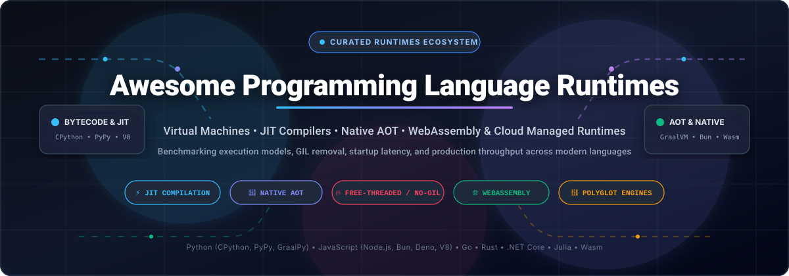

# ⚡ Awesome Programming Language Runtimes

**A curated index of high-performance virtual machines, Just-In-Time (JIT) compilers, Ahead-Of-Time (AOT) native engines, WebAssembly execution layers, and cloud runtime platforms.**

  
  
  
  
  

---

## 📖 Executive Summary & Architecture Scope

A **programming language runtime** defines the underlying execution environment responsible for interpreting, compiling, memory-managing, and scheduling program code. The runtime architecture dictates:
- **Startup Latency vs. Peak Throughput**: Bytecode interpreters start immediately with zero compilation overhead, while Tracing/Method JIT compilers require warmup periods before delivering orders-of-magnitude faster loop and kernel throughput.
- **Memory Footprint & LLC Cache Efficiency**: AOT native compilation (e.g., Nuitka, Codon, Go, Rust) eliminates runtime VM structures at the cost of compilation time and profile agility.
- **Concurrency & Parallelism Models**: From Global Interpreter Lock (GIL) elimination in modern CPython free-threaded builds to M:N green-threading (Go goroutines) and event-loop single-threaded isolates (Node.js, Bun, Deno).
- **Portability & Isolation**: Universal bytecode runtimes (JVM, CLR), browser-first sandboxes (Wasmtime, Pyodide), and lightweight V8 isolates.

---

## 📑 Table of Contents

- [📊 Sector Overview & Market Dynamics](#-sector-overview--market-dynamics)
- [☁️ SaaS & Hosted Managed Runtime Platforms](#️-saas--hosted-managed-runtime-platforms)
- [🐙 Top Open-Source Language Runtimes](#-top-open-source-language-runtimes)
  - [1. Go Runtime](#1-golanggo-)
  - [2. Node.js](#2-nodejsnode-)
  - [3. Rust Language Runtime & Stdlib](#3-rust-langrust-)
  - [4. Deno](#4-denolanddeno-)
  - [5. Bun](#5-oven-shbun-)
  - [6. CPython](#6-pythoncpython-)
  - [7. Julia Runtime & LLVM JIT](#7-julialangjulia-)
  - [8. Zig Toolchain & Minimal Runtime](#8-ziglangzig-)
  - [9. Ruby CRuby & YJIT](#9-rubyruby-)
  - [10. GraalVM Polyglot Runtime](#10-oraclegraal-)
  - [11. Wasmer WebAssembly Runtime](#11-wasmeriowasmer-)
  - [12. Wasmtime WASI Runtime](#12-bytecodealliancewasmtime-)
  - [13. PyScript](#13-pyscriptpyscript-)
  - [14. .NET Core Runtime](#14-dotnetruntime-)
  - [15. Codon High-Performance Python Compiler](#15-exaloopcodon-)
  - [16. Nuitka Python-to-C Compiler](#16-nuitkanuitka-)
  - [17. Pyodide WebAssembly Python](#17-pyodidepyodide-)
  - [18. Hermes JavaScript Engine](#18-facebookhermes-)
  - [19. Numba JIT Compiler](#19-numbanumba-)
  - [20. Brython Browser Python](#20-brython-devbrython-)
  - [21. LuaJIT](#21-luajitluajit-)
  - [22. JupyterLite In-Browser Runtime](#22-jupyterlitejupyterlite-)
  - [23. PyPy Tracing JIT](#23-pypypypy-)
  - [24. GraalPy Native Standalone](#24-oraclegraalpython-)
- [⚖️ Architectural Selection Matrix](#️-architectural-selection-matrix)
- [🤝 How to Contribute](#-how-to-contribute)
- [⚠️ Disclaimer](#️-disclaimer)
- [📈 Star History](#-star-history)
- [💖 Support & Sponsoring](#-support--sponsoring)

---

## 📊 Sector Overview & Market Dynamics

The global serverless execution and managed compute runtime market was estimated at **$14.5 Billion in 2024** and is projected to expand to **$45.8 Billion by 2030**, compounding at a **CAGR of 21.8%**. 

**Market Structure & Concentration Dynamics:**
- **Hyperscaler Infrastructure Core (Highly Concentrated / Oligopolistic)**: The foundation of enterprise managed runtimes is heavily consolidated among three hyperscale providers — Amazon Web Services (AWS Lambda), Microsoft Azure (Azure Functions), and Alphabet (Google Cloud Run). These three capture over 72% of global managed runtime infrastructure workloads, competing on global footprint, hardware fleet discounts, and deep integration into cloud IAM and data backends.
- **Edge Runtime & Developer Isolation Layer (Moderately Fragmented / Specialized Niches)**: Above raw infrastructure, the market fragments into specialized developer experience and edge execution layers. Cloudflare Workers pioneered sub-millisecond cold starts via V8 isolates; Vercel optimized hybrid serverless edge rendering for web frameworks; while Posit (R/Python) and JuliaHub dominate scientific, statistical, and high-performance technical computing runtimes.

---

## ☁️ SaaS & Hosted Managed Runtime Platforms

The following hosted managed compute platforms provide fully configured runtime environments for executing code at scale without manual operating system provisioning.

> Sorted descending by **Company Valuation / Market Cap**.

| Platform / Provider | Company Size (Valuation / Revenue) | Starting Tier Pricing | Free Tier Limit | Supported Runtimes & Key Architecture |
| :--- | :--- | :--- | :--- | :--- |
| **[Microsoft Azure Functions](https://azure.microsoft.com/products/functions/)** | **~$3.10 Trillion** (Market Cap) • Azure Rev: ~$75B+/yr | **$0.20 per 1M executions** + **$0.000016/GB-s** on standard Consumption plan | **1,000,000 executions** & **400,000 GB-s** compute consumption per month (Free forever) | C#, F#, Java, JavaScript, TypeScript, Python, PowerShell; supports custom Linux container runtimes and Flex Consumption instances. |
| **[Amazon AWS Lambda](https://aws.amazon.com/lambda/)** | **~$2.10 Trillion** (Market Cap) • AWS Rev: ~$105B+/yr | **$0.20 per 1M requests** + **$0.0000166667 per GB-s** (x86) / **$0.0000133334 per GB-s** (Graviton ARM) | **1,000,000 free requests** & **3,200,000 seconds** (400,000 GB-s) compute time per month (Free forever) | Native runtimes for Node.js, Python, Java, Go, Ruby, .NET 8; supports custom microVM runtimes via Firecracker and container images up to 10 GB. |
| **[Google Cloud Run](https://cloud.google.com/run)** | **~$2.00 Trillion** (Market Cap) • GCP Rev: ~$40B+/yr | **$0.40 per 1M requests** + **$0.00002400/vCPU-s** + **$0.00000250/GiB-s** | **2,000,000 requests**, **180,000 vCPU-seconds**, **360,000 GiB-seconds**, and **1 GiB egress** per month (Free forever) | Executes any language runtime packaged as an OCI container image (Python, Node, Go, Rust, Java, C++, Ruby); automatic horizontal scaling to zero. |
| **[Cloudflare Workers](https://workers.cloudflare.com/)** | **~$35.0 Billion** (Market Cap) • Rev: ~$1.6B+/yr | **$5.00 / month** (Workers Paid plan includes 10M requests; +$0.30 per 1M additional requests) | **100,000 requests per day** across all Worker scripts with up to **10ms CPU time per request** (Free forever) | Lightweight V8 isolate runtime; zero cold-start execution for JavaScript, TypeScript, Rust, C/C++, and WebAssembly modules across 330+ edge PoPs. |
| **[Vercel Functions](https://vercel.com/products/serverless-functions)** | **~$3.25 Billion** (Valuation) • ARR: ~$150M+ | **$20.00 / seat / month** (Pro plan; includes 1M edge executions, +$0.60 per 1M additional executions) | **Hobby Plan (Free forever)**: **100 GB-hours** serverless execution, **1,000,000 edge invocations/mo**, max 100 fast deployments/day | Frontend and full-stack runtime infrastructure optimized for Next.js, Node.js, Python 3.12, Go, and WebAssembly edge middleware. |
| **[Posit Cloud & Workbench](https://posit.co/products/enterprise/workbench/)** | **~$1.10 Billion** (Valuation) • Rev: ~$75M+ | **$5.00 / month** (Posit Cloud Plus; enterprise Posit Workbench server licenses start at **$9,950 / year**) | **Posit Cloud Free Plan**: **25 project compute hours/mo**, 1 shared vCPU, 1 GB RAM, up to 5 concurrent projects (Free forever) | Enterprise centralized compute environments for R (CRAN), Python (CPython/Jupyter), and Quarto; supports Kerberos, SSO, and cluster execution backends. |
| **[JuliaHub](https://juliahub.com/)** | **~$120 Million** (Valuation) • Rev: ~$15M | **$0.20 per compute-hour** (pay-as-you-go on 2-vCPU / 8GB instances) or **$20.00 / user / month** (Standard plan) | **Community Tier**: **20 free compute hours/month** on 2-vCPU nodes (or 14-day Enterprise Trial with **$50 cloud credits**) | Specialized cloud compute platform for the Julia runtime; integrated package precompilation cache, distributed cluster computing, and GPU-accelerated JIT. |

---

## 🐙 Top Open-Source Language Runtimes

The open-source ecosystem provides developers with transparent compilation internals, customizable memory collectors, and drop-in execution alternatives.

> Sorted descending by **GitHub Stars_Count**. Every Stars_Badge links directly to the repository's live stargazers page.

---

### 1. [golang/go](https://github.com/golang/go) 
- 🚀 **Core Architecture**: Ahead-of-time (AOT) compiled systems language runtime with concurrent tri-color mark-sweep garbage collection and an M:N work-stealing scheduler for lightweight goroutines.
- ⚡ **Performance Profile**: Sub-millisecond process startup time, predictable garbage collection pauses strictly maintained under 1ms, and efficient native assembly generation across x86, ARM, and RISC-V.
- 🎯 **Best Used For**: High-concurrency network servers, cloud-native orchestration engines (Kubernetes, Docker, Terraform), microservices, and high-throughput backend APIs.

---

### 2. [nodejs/node](https://github.com/nodejs/node) 
- 🚀 **Core Architecture**: Asynchronous, event-driven JavaScript runtime built on Google's V8 engine and the libuv cross-platform asynchronous I/O abstraction layer.
- ⚡ **Performance Profile**: In single-core WebSocket benchmarks, Node.js 26 utilizing `uWebSockets.js` handles up to **49,000 round trips per second** with a 99th percentile latency of **24.8µs**.
- 🎯 **Best Used For**: Production enterprise microservices, real-time streaming backends, npm-powered full-stack ecosystems, and developer tooling CLI automation.

---

### 3. [rust-lang/rust](https://github.com/rust-lang/rust) 
- 🚀 **Core Architecture**: Zero-cost abstraction native systems runtime with compile-time affine type system, static borrow checking, and no mandatory garbage collector or virtual machine overhead.
- ⚡ **Performance Profile**: Parity with hand-optimized C/C++ in raw compute throughput, minimal memory overhead, zero runtime deoptimization pauses, and deterministic memory deallocation.
- 🎯 **Best Used For**: Operating system kernels, high-frequency trading engines, WebAssembly compilation targets, cryptographic libraries, and browser layout engines.

---

### 4. [denoland/deno](https://github.com/denoland/deno) 
- 🚀 **Core Architecture**: Secure modern runtime for JavaScript, TypeScript, and WebAssembly written in Rust, powered by the V8 engine and Tokio async event runtime.
- ⚡ **Performance Profile**: Benchmarked at **40,000 WebSocket round trips per second** (99th percentile latency of 32.0µs); native TypeScript compilation via fast Rust-based SWC parser.
- 🎯 **Best Used For**: Security-sensitive microservices with granular permission sandboxing (file, network, env), modern TypeScript-first web backends, and edge compute services.

---

### 5. [oven-sh/bun](https://github.com/oven-sh/bun) 
- 🚀 **Core Architecture**: All-in-one JavaScript & TypeScript runtime, native bundler, transpiler, and package manager written from scratch in Zig and powered by Apple's WebKit JavaScriptCore engine.
- ⚡ **Performance Profile**: Delivers 3x to 4x faster cold starts compared to Node.js; handles **37,000 WebSocket round trips per second** with built-in native SQLite and HTTP server optimizations.
- 🎯 **Best Used For**: Ultra-fast developer workflows, instant package installation, rapid CLI utility execution, and full-stack web applications requiring minimal toolchain friction.

---

### 6. [python/cpython](https://github.com/python/cpython) 
- 🚀 **Core Architecture**: The standard reference implementation of Python; uses a stack-based bytecode compiler and virtual machine interpreter with reference counting and cyclic garbage collection.
- ⚡ **Performance Profile**: Python 3.13 and 3.14 introduce the experimental **Copy-and-Patch JIT** delivering **20–30% speedups** on CPU-bound routines, alongside the historic **free-threaded build (PEP 703)** removing the Global Interpreter Lock (GIL) for true multi-core parallel thread execution.
- 🎯 **Best Used For**: Universal compatibility baseline, machine learning & AI workflows (PyTorch, TensorFlow), data engineering, scientific research, and enterprise web backends.

---

### 7. [julialang/julia](https://github.com/julialang/julia) 
- 🚀 **Core Architecture**: Dynamic high-level technical language featuring multiple dispatch, type inference, and an LLVM-based Just-In-Time (JIT) code generator producing native machine instructions.
- ⚡ **Performance Profile**: Solves the "two-language problem" by executing dynamic scientific code at native C/Fortran speeds; provides built-in SIMD vectorization and multi-threaded parallel array operations.
- 🎯 **Best Used For**: Numerical simulation, scientific machine learning (SciML), differential equations, algorithmic finance, and large-scale mathematical modeling.

---

### 8. [ziglang/zig](https://github.com/ziglang/zig) 
- 🚀 **Core Architecture**: General-purpose systems language and toolchain featuring compile-time code execution (`comptime`), explicit memory allocators, and no hidden control flow or runtime overhead.
- ⚡ **Performance Profile**: Near-zero binary footprint, optimal cache locality, and capable of functioning as a drop-in C/C++ cross-compiler targeting all major architectures without external dependencies.
- 🎯 **Best Used For**: High-performance systems programming, game development, embedded devices, audio DSP processing, and building next-generation language runtimes (e.g., Bun).

---

### 9. [ruby/ruby](https://github.com/ruby/ruby) 
- 🚀 **Core Architecture**: The official reference implementation of Ruby (CRuby / MRI) featuring the YARV (Yet Another Ruby VM) bytecode interpreter and the **YJIT (Shopify's Lazy Basic Block Versioning JIT)**.
- ⚡ **Performance Profile**: YJIT delivers **15% to 40% real-world throughput gains** on heavy Ruby on Rails workloads while maintaining 100% C-extension compatibility and minimal memory overhead.
- 🎯 **Best Used For**: Rapid web application development (Ruby on Rails), developer productivity, automation scripting, and e-commerce platforms.

---

### 10. [oracle/graal](https://github.com/oracle/graal) 
- 🚀 **Core Architecture**: High-performance polyglot virtual machine and compiler platform supporting Java, Scala, Kotlin, JavaScript, Python, Ruby, and LLVM bitcode inside a unified memory runtime.
- ⚡ **Performance Profile**: GraalVM Native Image generates standalone AOT binaries with sub-10ms startup times and zero warmup overhead, dramatically slashing memory usage in Kubernetes pods.
- 🎯 **Best Used For**: Microservices architectures (Quarkus, Micronaut, Spring Native), polyglot enterprise applications, and cloud-native serverless deployments.

---

### 11. [wasmerio/wasmer](https://github.com/wasmerio/wasmer) 
- 🚀 **Core Architecture**: Universal WebAssembly (Wasm) runtime enabling lightweight, secure containers that run on any platform from desktop to edge servers and embedded devices.
- ⚡ **Performance Profile**: Pluggable compiler backends (Singlepass for instant compilation, Cranelift for fast development, and LLVM for peak execution performance); near-native execution speeds.
- 🎯 **Best Used For**: Edge computing plugins, multi-tenant untrusted code sandboxing, cross-platform CLI tool distribution, and WebAssembly package management (WAPM).

---

### 12. [bytecodealliance/wasmtime](https://github.com/bytecodealliance/wasmtime) 
- 🚀 **Core Architecture**: Standalone, standards-compliant WebAssembly and WASI (WebAssembly System Interface) runtime developed under the Bytecode Alliance using the Cranelift code generator.
- ⚡ **Performance Profile**: Hardened memory safety implemented in Rust, microsecond instantiation latencies, low memory overhead, and full support for the Component Model and WASI 0.2.
- 🎯 **Best Used For**: Embedding sandboxed plugin engines in host applications (Rust, C, Python, Go), serverless edge functions (Fastly Compute@Edge), and zero-trust computing environments.

---

### 13. [pyscript/pyscript](https://github.com/pyscript/pyscript) 
- 🚀 **Core Architecture**: Browser-side execution framework that integrates Python directly into standard HTML tags, leveraging Pyodide and MicroPython compiled to WebAssembly.
- ⚡ **Performance Profile**: Provides bidirectional DOM manipulation and JavaScript-Python event bridging; loads client-side within 1–3 seconds depending on cached WASM artifacts.
- 🎯 **Best Used For**: Client-side data visualization, interactive educational tutorials, dashboard prototypes, and zero-install scientific demos.

---

### 14. [dotnet/runtime](https://github.com/dotnet/runtime) 
- 🚀 **Core Architecture**: Modern, cross-platform .NET runtime (CoreCLR) and garbage collector powering C#, F#, and Visual Basic with tiered JIT compilation and RyuJIT optimizations.
- ⚡ **Performance Profile**: Consistently ranks at the top of TechEmpower web benchmarks; features Native AOT compilation for instantaneous startup, PGO (Profile-Guided Optimization), and dynamic vectorization.
- 🎯 **Best Used For**: Enterprise web APIs (ASP.NET Core), high-throughput financial backends, game development (Unity, Godot), and desktop applications.

---

### 15. [exaloop/codon](https://github.com/exaloop/codon) 
- 🚀 **Core Architecture**: High-performance Ahead-of-Time (AOT) compiler for a statically-typed subset of Python, generating optimized native machine instructions via the LLVM compiler infrastructure.
- ⚡ **Performance Profile**: Delivers **10x to 100x speedups** over vanilla CPython on single-threaded numerical routines; benchmarks show 26x gains on N-body and 142x on spectral-norm.
- 🎯 **Best Used For**: High-throughput computational kernels, bioinformatics pipelines, quantitative finance algorithms, and compute-bound loops where CPython compatibility can be scoped.

---

### 16. [Nuitka/Nuitka](https://github.com/Nuitka/Nuitka) 
- 🚀 **Core Architecture**: Python-to-C transpiler and compiler that transforms Python modules into C source code and builds standalone, native executable binaries using standard C compilers (GCC, Clang, MSVC).
- ⚡ **Performance Profile**: Lowest average memory footprint among tested Python runtimes; eliminates Python bytecode dependency and protects intellectual property via native binary compilation.
- 🎯 **Best Used For**: Packaging and commercial distribution of standalone desktop apps, background daemons, security utilities, and memory-constrained production environments.

---

### 17. [pyodide/pyodide](https://github.com/pyodide/pyodide) 
- 🚀 **Core Architecture**: Full CPython runtime compiled to WebAssembly via Emscripten, complete with transparent JavaScript-Python object conversion and native package wheel support.
- ⚡ **Performance Profile**: Runs numerical libraries (NumPy, SciPy, Pandas, scikit-learn) inside the browser at **80–100% of native speed**; startup completed within 2–4 seconds over CDN.
- 🎯 **Best Used For**: Browser-based data science environments (JupyterLite), interactive documentation, client-side data analysis, and serverless edge functions without backend compute costs.

---

### 18. [facebook/hermes](https://github.com/facebook/hermes) 
- 🚀 **Core Architecture**: Lightweight JavaScript engine optimized for running React Native applications on mobile platforms and embedded devices.
- ⚡ **Performance Profile**: Features Ahead-Of-Time (AOT) bytecode precompilation, specialized compact bytecode representation, and a generational, non-moving garbage collector minimizing TTI (Time to Interactive).
- 🎯 **Best Used For**: Mobile applications (Android & iOS), memory-constrained IoT devices, and embedded JavaScript engines requiring rapid application launch.

---

### 19. [numba/numba](https://github.com/numba/numba) 
- 🚀 **Core Architecture**: NumPy-aware JIT compiler for Python that translates annotated mathematical Python functions into optimized machine code using LLVM at runtime.
- ⚡ **Performance Profile**: Matches raw C and Fortran speeds on numerical array operations; supports automatic loop parallelization (`prange`) and direct GPU compilation (NVIDIA CUDA, AMD ROCm).
- 🎯 **Best Used For**: Accelerating scientific array math, physical simulations, quantitative risk modeling, and custom GPU kernel authoring directly in Python.

---

### 20. [brython-dev/brython](https://github.com/brython-dev/brython) 
- 🚀 **Core Architecture**: Pure JavaScript implementation of Python 3 designed to replace JavaScript as the scripting language for web pages in the browser.
- ⚡ **Performance Profile**: Near-instantaneous page load time with zero WebAssembly compilation payload; interacts directly with the DOM and standard browser Web APIs.
- 🎯 **Best Used For**: Educational web applications, quick front-end Python scripting, and lightweight browser tools that do not require heavyweight C extensions (NumPy/Pandas).

---

### 21. [LuaJIT/LuaJIT](https://github.com/LuaJIT/LuaJIT) 
- 🚀 **Core Architecture**: Trace-based Just-In-Time compiler for the Lua language, renowned as one of the fastest dynamic language runtimes in computer science history.
- ⚡ **Performance Profile**: Extremely compact runtime footprint (under 1 MB binary size), ultra-fast trace generation, and a high-performance FFI (Foreign Function Interface) library for calling C functions directly.
- 🎯 **Best Used For**: High-throughput web reverse proxies (OpenResty, Kong API Gateway), game engine scripting (World of Warcraft, Corona), and embedded real-time systems.

---

### 22. [jupyterlite/jupyterlite](https://github.com/jupyterlite/jupyterlite) 
- 🚀 **Core Architecture**: Wasm-powered Jupyter distribution that runs entirely inside the client's web browser, using Pyodide and WebAssembly kernels without requiring a backend server.
- ⚡ **Performance Profile**: Zero cloud infrastructure hosting costs, offline-capable via service workers, and instantaneous notebook deployment from static web hosts (GitHub Pages).
- 🎯 **Best Used For**: Interactive textbook publishing, hands-on workshop environments, reproducible research notebooks, and zero-maintenance student laboratories.

---

### 23. [pypy/pypy](https://github.com/pypy/pypy) 
- 🚀 **Core Architecture**: Alternative Python runtime built using the RPython framework, featuring an advanced tracing Just-In-Time (JIT) compiler and high-performance garbage collector.
- ⚡ **Performance Profile**: Delivers **up to 45x speedups** over standard CPython on pure Python, math-heavy, long-running loops; consumes higher memory during tracing warmup.
- 🎯 **Best Used For**: Long-running CPU-bound data transformation services, financial modeling simulations, and pure Python backend processes.

---

### 24. [oracle/graalpython](https://github.com/oracle/graalpython) 
- 🚀 **Core Architecture**: Python 3.12-compliant runtime implemented using GraalVM's Truffle language implementation framework and compiled as a standalone native binary.
- ⚡ **Performance Profile**: Seamless polyglot interoperability allowing zero-copy object passing between Python, Java, JavaScript, and Ruby on a single execution runtime.
- 🎯 **Best Used For**: Polyglot enterprise systems, embedding Python machine learning models into existing Java/JVM enterprise backends, and sandboxed scripting execution.

---

## ⚖️ Architectural Selection Matrix

| Optimization Goal | Recommended Runtime | Rationale & Trade-offs |
| :--- | :--- | :--- |
| **Maximum Web/API Throughput** | **Node.js** or **Go** | Asynchronous non-blocking I/O with mature connection pooling; Go provides predictable sub-millisecond GC pauses. |
| **Low-Latency Edge Execution** | **Cloudflare Workers** or **Wasmtime** | Sub-millisecond V8 isolate / Wasm instantiation eliminates container cold-start latency. |
| **Pure-Python Numerical Speed** | **Numba** or **PyPy** | Numba compiles array loops to LLVM machine code; PyPy accelerates long-running dynamic loops. |
| **Enterprise Compatibility Baseline** | **CPython 3.13+** | Guarantees 100% C-extension ecosystem compatibility; offers experimental JIT and free-threaded builds. |
| **Polyglot Interoperability** | **GraalVM** | Run Python, Java, Ruby, and JavaScript in a shared memory heap with zero serialization overhead. |
| **Standalone Executable Distribution** | **Nuitka** or **Zig** | Transpiles and links into self-contained native binaries without external runtime dependencies. |
| **Zero-Server Browser Data Science** | **Pyodide** / **JupyterLite** | Executes scientific Python packages directly on the client machine via WebAssembly. |

---

## 🤝 How to Contribute

We welcome contributions from runtime engineers, systems architects, and open-source enthusiasts!

1. 🍴 **Fork the repository** to your GitHub profile.
2. 🌿 **Create a new branch**: `git checkout -b feature/runtime-entry`.
3. 📝 **Add or update an entry**: Ensure descriptions are factual, benchmark citations are verified, and valid pricing/free-tier constraints are documented.
4. 🧪 **Check link integrity**: Verify all hyperlinks and Stars_Badges function properly.
5. 🚀 **Submit a Pull Request**: Include a brief overview of changes and relevant reference sources.

---

## ⚠️ Disclaimer

- This repository is a **community-curated index** intended for architectural evaluation and technical benchmarking. Listings do not constitute commercial endorsement.
- Performance characteristics vary heavily across real-world workloads: JIT compilers introduce warmup latency, AOT compilers require build time, and browser WebAssembly requires client memory overhead. Always benchmark against your specific production workload before committing to architectural migrations.

---

## 📈 Star History

---

## 💖 Support & Sponsoring

Thank you for exploring this curated guide to programming language runtimes! If this resource has helped you benchmark, optimize, or select the best runtime architecture for your applications, please consider supporting the project:

- ⭐ **Star this repository** on GitHub to help others discover it.
- 🍴 **Fork and contribute** by submitting PRs with new runtimes or updated benchmarks.
- 📢 **Share** this list with colleagues, engineering communities, and dev teams.
- ☕ **Buy me a coffee / Sponsor**: If you'd like to support ongoing research and curation across developer tooling, visit my [GitHub Sponsor Dashboard](https://github.com/sponsors/ishandutta2007). Your sponsorship helps keep these ecosystem resources actively maintained and up to date!

---

  Maintained with ❤️ by <a href="https://github.com/ishandutta2007">Ishan Dutta</a> and the global open-source community.

